  

# 🎨 Awesome Vector Graphics Software

  <strong>The definitive, SEO-optimized guide to professional SaaS design suites, browser-based SVG editors, procedural node engines, and open-source illustration platforms.</strong>

  
  
  
  
  
  
  

---

> **Keywords:** vector graphics software, open source illustrator alternative, SVG editor, vector design tools, procedural vector graphics, free vector editor, Penpot, Inkscape, Graphite, CMYK vector editor, Linux vector design, browser SVG editor.

---

## 📑 Table of Contents

- [📊 Sector Overview & Market Dynamics](#-sector-overview--market-dynamics)
- [🏢 SaaS & Hosted Vector Graphics Platforms](#-saas--hosted-vector-graphics-platforms)
- [⚡ Open-Source GitHub Projects](#-open-source-github-projects)
- [🔬 Architecture & Capabilities Matrix](#-architecture--capabilities-matrix)
- [❓ Frequently Asked Questions (FAQ)](#-frequently-asked-questions-faq)
- [🤝 How to Contribute](#-how-to-contribute)
- [💖 Support & Sponsorship](#-support--sponsorship)
- [⭐ Star History](#-star-history)
- [⚖️ License & Disclaimer](#️-license--disclaimer)

---

## 📊 Sector Overview & Market Dynamics

The global **vector graphics and digital illustration software market** is currently valued at approximately **$3.8 billion to $4.2 billion (2026)**, projected to reach **$7.5 billion by 2033** at an estimated compound annual growth rate (CAGR) of **8.9%**. Market expansion is propelled by rising demand for responsive Web SVG assets, design systems, UI/UX asset pipelines, print merchandise automation, and real-time collaborative whiteboarding.

Historically, the vector sector exhibited **high market concentration with near-oligopolistic characteristics**, dominated for decades by **Adobe Illustrator** in commercial prepress and brand agency workflows, flanked by **CorelDRAW** in industrial signage and physical fabrication. However, the modern ecosystem has evolved into a **moderately fragmented, multi-tiered competitive landscape**:

1. **Commercial Dominance vs. Subscription Backlash:** While Adobe maintains a near "winner-take-all" stranglehold on enterprise client deliverables (`.ai` format mandates), Canva's acquisition of Affinity Designer disrupted the pricing model by offering lifetime perpetual licensing and zero-subscription professional bundles.
2. **Cloud-Native & Multiplayer Revolution:** Collaborative platforms like Figma and open-source equivalents like Penpot shifted vector manipulation into the browser DOM and WebAssembly, turning isolated vector drawing into collaborative, team-wide workflows.
3. **The Rise of Procedural & Rust-Native Engines:** Modern non-destructive procedural workflows (exemplified by Graphite) and memory-safe Rust native engines (such as VectorCraft) are decoupling vector editing from legacy desktop monoliths, establishing an open-source standard for generative and node-driven graphic design.

---

## 🏢 SaaS & Hosted Vector Graphics Platforms

The table below highlights leading commercial and hosted SaaS vector design platforms. It is sorted in **descending order by company scale** (market capitalization or private valuation).

| 🏷️ Platform | 🏢 Company Scale (Valuation / Revenue) | 💳 Pricing (Starting Tier) | 🎁 Free Tier / Trial Limits | 💻 Supported Platforms | 🎯 Primary Strengths & Deliverables |
| :--- | :--- | :--- | :--- | :--- | :--- |
| [**Adobe Illustrator**](https://www.adobe.com/products/illustrator.html) | **Adobe Inc.** Valuation: **~$225 Billion** (Market Cap) Annual Revenue: ~$21.4B | **$22.99 / month** (Annual commitment billed monthly) or **$34.49 / month** (Billed monthly, cancel anytime) | **7-Day Free Trial**: Full unrestricted access to all desktop & iPad vector tools, generative AI Firefly credits, and 100GB cloud storage. Credit card required at registration; auto-renews unless canceled before trial end. No permanent free tier. | Windows, macOS, iPadOS | De facto global print and packaging industry standard; unmatched bezier control, advanced gradient meshes, typography variable fonts, and CMYK prepress color separations (`.ai`, `.eps`, `.pdf`). |
| [**Canva & Affinity Designer**](https://affinity.serif.com/en-us/designer/) | **Canva Pty Ltd (Serif)** Valuation: **~$26 Billion** (Private Valuation) Annual Revenue: ~$2.3B | **$69.99 one-time** perpetual desktop license (or $164.99 V2 Universal Suite); **Canva Pro: $14.99 / month** or **$119.99 / year** | **30-Day Free Trial** (Affinity): Complete, unrestricted access to all vector and raster personas with no credit card required. **Canva Free Forever**: 5GB cloud storage, 1M+ free assets, basic vector/raster export (transparent SVG export requires Pro). | Windows, macOS, iPadOS, Web (Canva) | Zero-subscription perpetual license model; seamless switching between 1,000,000% zoom vector engine and raster pixel persona; native Pantone libraries and CMYK color workflows (`.afdesign`, `.svg`, `.pdf`). |
| [**Figma**](https://www.figma.com/) | **Figma Inc.** Valuation: **~$12.5 Billion** (Tender Offer / Valuation) Annual Revenue: ~$700M+ | **$12 / editor / month** (Billed annually at $144/yr) or **$15 / editor / month** (Billed monthly) on Figma Professional | **Starter Free Forever Plan**: Exactly 3 collaborative Figma design files, 3 FigJam whiteboard files, unlimited personal drafts, 30-day version history, and unlimited viewers/commenters. | Web Browser, macOS, Windows, iOS, Android | Innovative "Vector Networks" allowing multidirectional path branching (unlike traditional closed loops); cloud-native multiplayer co-editing; Auto Layout; component token engines (`.fig`, `.svg`, `.pdf`). |
| [**CorelDRAW Graphics Suite**](https://www.coreldraw.com/) | **Alludo (formerly Corel / KKR)** Valuation: **~$1.2 Billion** (Private Equity Acquisition) Annual Revenue: ~$300M+ | **$22.42 / month** (Billed annually at $269/yr) or **$549.00 one-time** perpetual single purchase | **15-Day Free Trial**: Full unrestricted access to vector drawing tools, PowerTRACE bitmap-to-vector engine, and Corel Cloud storage. No credit card required. No permanent free tier. | Windows, macOS, Web (CorelDRAW.app) | Heavy industrial vector design, signage production, large-format billboard output, laser engraving, textile screen printing, and decades of legacy `.cdr` archival support. |
| [**Sketch**](https://www.sketch.com/) | **Sketch B.V.** Valuation: **~$300 Million** (Estimated Valuation) Annual Revenue: ~$45M+ | **$10 / editor / month** (Billed annually at $120/yr) or **$12 / month** monthly subscription; **$120 one-time** Mac-only perpetual license | **30-Day Free Trial**: Full access to native macOS vector canvas, real-time shared workspace, Mac local document saving, and developer web inspector. No credit card required. No permanent free tier. | macOS native client, Web workspace viewer | Hyper-optimized native macOS Cocoa app with hardware metal acceleration; nested vector symbols, smart layout, and color management tailored for digital UI and iconography (`.sketch`, `.svg`). |
| [**Linearity Curve**](https://www.linearity.io/curve/) | **Linearity GmbH** Valuation: **~$120 Million** (Series A EQT Ventures) Annual Funding: ~$14.5M Raised | **$9.99 / month** (Billed annually at $119.88/yr) or **$14.99 / month** on monthly billing for Linearity Pro | **Free Forever Starter Plan**: Maximum 3 active documents/projects, basic vector export (standard resolution SVG/PNG), 5 AI generation credits per month, and full Apple Pencil pressure/tilt support. | macOS, iPadOS, iOS (Apple Ecosystem) | Precision mobile-to-desktop vector illustration built specifically for Apple Silicon and Apple Pencil; built-in raster-to-vector auto-trace, node path simplification, and shape builders. |
| [**Vectr**](https://vectr.com/) | **Inmagine Group** Valuation: **~$60 Million** (Parent Entity Valuation) Annual Revenue: ~$25M+ | **$3.99 / month** or **$14.99 / year** for Vectr Premium | **Free Forever Plan**: Ad-supported browser workspace, 30MB cloud file storage, and up to 10 exported vector graphics files per month. Unlimited local vector canvas editing. | Web Browser, Windows, Linux, ChromeOS | Zero-friction onboarding for non-designers; cloud URL sharing for live canvas reviews; simplified pen, pencil, and pathfinder shape manipulation. |
| [**Boxy SVG**](https://boxy-svg.com/) | **Boxy SVG (Jarosław Foksa)** Valuation: **~$2.5 Million** (Independent Bootstrapped Studio) Annual Revenue: ~$400K+ | **$9.99 / year** ($0.83/mo) for Standard Web/PWA or **$19.99 one-time** Mac App Store / Microsoft Store purchase | **15-Day Free Web Trial**: Full unrestricted access to SVG authoring, local disk file system sync, and code editor. No account registration or credit card required. No perpetual free cloud tier. | Web (PWA), macOS, Windows, Linux, ChromeOS | Pure W3C-compliant SVG editor that treats SVG markup as first-class citizen with no proprietary metadata wrappers; ideal for front-end web developers and iconographers. |

---

## ⚡ Open-Source GitHub Projects

A curated collection of free, open-source vector graphics editors, procedural illustration suites, and SVG engines.

> 💡 **Sorted in descending order by GitHub_Stars.** Every entry features a live GitHub Stars_Badge linked directly to its repository stargazers page.

---

### 1. [Penpot](https://github.com/penpot/penpot) 
- **Primary Focus:** Web-based, open-source design and prototyping platform built natively on open web standards (SVG).
- **Tech Stack & Engine:** Clojure, ClojureScript, WebGL, SVG DOM rendering.
- **Key Features:**
  - Native SVG storage model — components and vectors map 1:1 to real SVG and CSS standards without proprietary transformation.
  - Full multiplayer collaborative canvas with comments, design tokens, and CSS Grid layout engines.
  - Self-hostable via Docker and Docker Compose with zero enterprise feature paywalls.
- **License:** MPL-2.0
- **Limitations:** Geared primarily toward digital screen UI/UX design and vector iconography rather than prepress CMYK printing.

---

### 2. [Graphite](https://github.com/GraphiteEditor/Graphite) 
- **Primary Focus:** In-development 2D procedural graphics engine combining non-destructive node graphs with traditional vector drawing.
- **Tech Stack & Engine:** Rust, WebAssembly, WebGPU / WGPU, Svelte interface.
- **Key Features:**
  - Node-based procedural generation graph alongside conventional layer stacks.
  - Blazing-fast Rust-based calculation pipeline running both natively on desktop and via WebAssembly in modern browsers.
  - Non-destructive vector booleans, procedural patterns, and upcoming raster compositing capabilities.
- **License:** Apache-2.0 / MIT Dual-License
- **Limitations:** Early alpha software undergoing rapid development; file formats and APIs are subject to breaking revisions before v1.0.

---

### 3. [VectorCraft](https://github.com/storytold/vectorcraft) 
- **Primary Focus:** High-performance, clean-room Rust implementation of an Illustrator-familiar vector illustration suite.
- **Tech Stack & Engine:** Pure Rust, Skia rendering engine backend, cross-platform GUI framework.
- **Key Features:**
  - Renders over 20,000 vector shapes in ~27ms at Retina resolutions.
  - Traditional professional pen tool, direct point selection, boolean shape operations, and bezier snapping.
  - Built-in raster image tracing (converting bitmap graphics into editable vector paths) and native PDF/SVG export.
- **License:** MIT / Apache-2.0
- **Limitations:** Independent community project under active alpha engineering; lacks third-party plugin ecosystem.

---

### 4. [SVG-Edit](https://github.com/SVG-Edit/svgedit) 
- **Primary Focus:** The reference open-source, in-browser SVG editor, maintained continuously for over 15 years.
- **Tech Stack & Engine:** Vanilla JavaScript, HTML5 Canvas, SVG DOM manipulation (`@svgedit/svgcanvas`).
- **Key Features:**
  - Modular architecture separating the headless SVG manipulation engine (`@svgedit/svgcanvas`) from the user interface.
  - Zero server dependency — runs client-side in any modern browser without installation.
  - Easily embeddable as an iframe or web component in custom web applications and CMS editors.
- **License:** MIT
- **Limitations:** Lacks boolean shape combinations (union/difference), variable font support, and advanced bezier curvature controls.

---

### 5. [vtracer](https://github.com/visioncortex/vtracer) 
- **Primary Focus:** High-speed raster-to-vector image converter that transforms JPG/PNG bitmaps into clean, scalable SVG paths.
- **Tech Stack & Engine:** Rust, WebAssembly, Multi-threaded curve fitting algorithms.
- **Key Features:**
  - Extracts color layers, traces smooth bezier splines, and outputs crisp SVG graphics without jagged pixel artifacts.
  - Available as both a high-throughput CLI tool and an interactive web-based browser demo.
  - Highly configurable curve tolerance, color precision, and corner threshold parameters.
- **License:** MIT
- **Limitations:** Pure vector tracing utility; does not provide an interactive path-drawing canvas or UI creation suite.

---

### 6. [SVG Path Editor](https://github.com/Yqnn/svg-path-editor) 
- **Primary Focus:** Specialized browser-based visual utility to inspect, create, simplify, and manipulate raw SVG `<path>` data strings.
- **Tech Stack & Engine:** TypeScript, React, HTML5 SVG.
- **Key Features:**
  - Direct bi-directional synchronization between the visual canvas and the raw SVG path command string (`M`, `C`, `S`, `Q`, `A`, `Z`).
  - Path optimization, absolute/relative coordinate conversion, and point rounding.
  - Coordinate grid with precision zoom and subpixel snapping.
- **License:** MIT
- **Limitations:** Tailored strictly for individual path inspection and glyph tuning, not multi-layer artwork or print publishing.

---

### 7. [Inkscape](https://github.com/inkscape/inkscape) 
- **Primary Focus:** The premier open-source desktop vector graphics editor, providing Illustrator-grade capabilities on Linux, Windows, and macOS.
- **Tech Stack & Engine:** C++, GTK3, Cairo 2D graphics engine.
- **Key Features:**
  - Comprehensive vector toolkit: Shape Builder tool, node editing, boolean operations, text on path, and live path effects (LPE).
  - W3C SVG is the native file format; imports and exports PDF, EPS, PostScript, DXF, and AI files.
  - Robust Python extension ecosystem and customizable keyboard shortcut bindings.
- **License:** GPL-3.0
- **Limitations:** Complex document rendering can experience UI latency; native CMYK print workflows require workarounds (via Scribus or PDF export profiles); GitHub is a mirror (primary development on GitLab).

---

### 8. [Method Draw](https://github.com/methodofaction/Method-Draw) 
- **Primary Focus:** Streamlined, minimalist browser SVG editor designed for effortless and approachable graphic creation.
- **Tech Stack & Engine:** JavaScript, CSS3, SVG DOM.
- **Key Features:**
  - Simplified fork of SVG-Edit stripped of cluttered panels, emphasizing immediate canvas access.
  - Instant loading in web browsers with local storage persistence.
  - Ideal for quickly producing SVG icons, simple logos, and clean diagram illustrations.
- **License:** MIT
- **Limitations:** Deliberately omits complex layers, advanced boolean operations, gradient mesh controls, and plugin hooks.

---

### 9. [GodSVG](https://github.com/MewPurPur/GodSVG) 
- **Primary Focus:** Desktop and web vector graphics application specifically optimized for structured and clean SVG file editing.
- **Tech Stack & Engine:** Godot Engine 4, GDScript / C++.
- **Key Features:**
  - Treats the SVG hierarchy directly as the document structure, ensuring zero redundant metadata tags.
  - Real-time path optimization and visual attribute inspector.
  - Multi-platform support: runs smoothly on Windows, Linux, macOS, and in WebAssembly browsers.
- **License:** MIT
- **Limitations:** Late alpha project; primarily designed for technical SVG authoring rather than freeform painterly illustration.

---

### 10. [macSVG](https://github.com/dsward2/macSVG) 
- **Primary Focus:** Native macOS application for designing HTML5 SVG artwork and interactive vector animations.
- **Tech Stack & Engine:** Objective-C, Cocoa, WebKit web view runtime.
- **Key Features:**
  - Graphical timeline animation editor supporting SVG/SMIL animation and CSS keyframe animations.
  - Embedded WebKit engine ensures that previewed rendering matches web browser behavior identically.
  - Native macOS interface with full Cocoa drag-and-drop and macOS system font integrations.
- **License:** MIT
- **Limitations:** Exclusively available on macOS; legacy codebase with periodic maintenance intervals.

---

### 11. [Mondrian](https://github.com/artursapek/mondrian) 
- **Primary Focus:** Lightweight, clean, and elegant web-based vector graphics editor.
- **Tech Stack & Engine:** CoffeeScript / JavaScript, Canvas, SVG.
- **Key Features:**
  - Intuitive user interface inspired by minimalist graphic design principles.
  - Straightforward path drawing, point dragging, and SVG / PNG download output.
  - Clean codebase suitable for educational vector rendering experiments.
- **License:** MIT
- **Limitations:** Vintage open-source project without active feature development for modern browser standards.

---

### 12. [VPaint](https://github.com/dalboris/vpaint) 
- **Primary Focus:** Experimental vector graphics and 2D animation editor based on Vector Animation Complexes (VAC).
- **Tech Stack & Engine:** C++, Qt, OpenGL.
- **Key Features:**
  - Allows topological boundary sharing between adjacent colored vector regions (adjacent faces share edges).
  - Revolutionary approach to 2D vector inbetweening and animation morphing.
  - Sculpting tools to push and pull vector paths dynamically like clay.
- **License:** Apache-2.0
- **Limitations:** Research prototype editor; successor project (VGC Illustration) is currently in development.

---

### 13. [sK1](https://github.com/sk1-project/sk1-wx) 
- **Primary Focus:** Cross-platform vector graphics editor built specifically for professional prepress and print publishing.
- **Tech Stack & Engine:** Python, C, wxWidgets, Cairo graphics engine.
- **Key Features:**
  - Native end-to-end CMYK colorspace support and ICC color profiling.
  - Universal importer for CorelDRAW (`.cdr`, `.cdt`, `.ccx` versions 7 to X4) and Adobe Illustrator files.
  - High-precision PostScript and PDF generation for commercial printing presses.
- **License:** GPL-3.0
- **Limitations:** Slower release cycle; UI conventions reflect legacy desktop publishing layouts.

---

### 14. [Karbon (Calligra)](https://github.com/KDE/calligra) 
- **Primary Focus:** The KDE ecosystem's native vector drawing application, integrated into the Calligra office suite.
- **Tech Stack & Engine:** C++, Qt5 / Qt6, KDE Frameworks.
- **Key Features:**
  - Highly customizable UI with modular dockers for paths, palettes, and typography.
  - Native integration with Linux desktop environments via Flatpak and native distribution package managers.
  - Support for ODG (OpenDocument Graphics), SVG, WPG, WMF, and EPS formats.
- **License:** GPL-2.0 / LGPL-2.0
- **Limitations:** Tightly coupled to the broader Calligra suite release train; less independent traction as a standalone tool.

---

### 15. [repath](https://github.com/repath-studio/repath-studio) 
- **Primary Focus:** Modern web-based vector graphics editor merging procedural tooling with direct artistic workflows.
- **Tech Stack & Engine:** TypeScript, React, HTML5 Canvas / WebGL.
- **Key Features:**
  - Intuitive node-assisted procedural modifiers applied on top of hand-drawn bezier curves.
  - Clean web-native interface with zero installation barrier.
  - Focus on responsive icon systems and generative vector art.
- **License:** GPL-3.0
- **Limitations:** Early-stage project with growing documentation and toolset maturity.

---

### 16. [Lucent Designer](https://github.com/lallmon/lucent-designer) 
- **Primary Focus:** Linux-first hybrid vector and raster design software inspired by Affinity Designer.
- **Tech Stack & Engine:** C++, Qt, QML.
- **Key Features:**
  - Dual-persona architecture bridging vector paths with bitmap pixel manipulation on Linux.
  - Tailored export pipelines for maker communities (laser cutters, plotter vinyls, and board game layouts).
  - Lightweight desktop footprint without heavy background telemetry.
- **License:** GPL-3.0
- **Limitations:** Emerging grassroots project in early pre-release stage.

---

## 🔬 Architecture & Capabilities Matrix

Understanding the architectural philosophy of your vector tool ensures seamless asset pipelines and prevents costly rework.

| Architecture Paradigm | Representatives | Strengths | Trade-Offs | Best Use Case |
| :--- | :--- | :--- | :--- | :--- |
| **Traditional Desktop Native** | Inkscape, Affinity Designer, Adobe Illustrator, CorelDRAW | Maximum GPU/CPU throughput, deep file format compatibility, complete CMYK prepress calibration. | Heavy installation footprint, manual local file synchronization, license/subscription overhead. | Commercial print production, high-complexity illustrations, prepress packaging. |
| **Cloud-Native Collaborative** | Penpot, Figma, Vectr | Real-time multi-user co-editing, zero installation, unified design token systems, instant web sharing. | Constant network reliance (for cloud tiers), memory constraints on ultra-large documents. | UI/UX design teams, web vector icons, multi-stakeholder design reviews. |
| **Procedural & Node-Based** | Graphite, repath | Fully non-destructive editing history, algorithmic asset variations, repeatable generative workflows. | Steeper initial learning curve, less intuitive for freeform organic brush drawing. | Generative vector patterns, game asset pipelines, technical parameter design. |
| **W3C SVG-Centric Technical** | Boxy SVG, SVG-Edit, GodSVG, SVG Path Editor | Clean 1:1 markup parity, no proprietary attributes or metadata clutter, instant browser testing. | Fewer painterly texture filters, basic CMYK conversion capabilities. | Web developers, SVG icon designers, interactive web animation authors. |

---

## ❓ Frequently Asked Questions (FAQ)

### 1. What is the most reliable free and open-source alternative to Adobe Illustrator?
For full-spectrum vector illustration and print prepress, **[Inkscape](https://github.com/inkscape/inkscape)** remains the most capable desktop open-source alternative with complete path, node, and SVG toolsets. For team collaboration, UI/UX systems, and browser-first SVG design, **[Penpot](https://github.com/penpot/penpot)** is the premier open-source cloud suite.

### 2. Can open-source vector software output production-ready CMYK for professional printing?
Yes, but tool choice matters:
- **[sK1](https://github.com/sk1-project/sk1-wx)** offers native CMYK colorspace support and ICC profile handling out of the box.
- **[Inkscape](https://github.com/inkscape/inkscape)** supports color-managed CMYK soft proofing and can output PDF/X-compliant files when configured with LittleCMS and appropriate ICC profiles.
- Commercial perpetual options like **Affinity Designer** provide instant native CMYK and Pantone support without recurring subscriptions.

### 3. What is the key advantage of procedural node-based vector design (e.g., Graphite)?
In conventional layer-based software, applying a boolean difference or path warp is destructive: undoing it requires stepping backward in history and discarding subsequent edits. In procedural engines like **[Graphite](https://github.com/GraphiteEditor/Graphite)**, operations are modeled as interconnected nodes. You can alter initial path coordinates or modifier parameters hours later, and the entire downstream vector graph recalculates automatically.

### 4. Which vector tools run natively on Linux?
Linux designers have excellent first-class options:
- **Open-Source:** [Inkscape](https://github.com/inkscape/inkscape), [Penpot](https://github.com/penpot/penpot) (browser/self-hosted), [Graphite](https://github.com/GraphiteEditor/Graphite), [Karbon](https://github.com/KDE/calligra), [GodSVG](https://github.com/MewPurPur/GodSVG), and [sK1](https://github.com/sk1-project/sk1-wx).
- **Proprietary / SaaS:** [Boxy SVG](https://boxy-svg.com/) and [Figma](https://www.figma.com/) run smoothly via modern Chromium/Linux browsers. Note that Affinity Designer and Adobe Illustrator lack native Linux releases.

---

## 🤝 How to Contribute

We welcome additions, updates, and benchmark contributions from designers and developers worldwide!

1. 🍴 **Fork the Repository:** Create a personal fork on GitHub.
2. 🌿 **Create a Branch:** `git checkout -b feature/add-vector-tool`
3. 📝 **Add Your Entry:**
   - Adhere strictly to the existing tabular or open-source list format.
   - For SaaS products, include exact starting prices, specific free tier limits, and verifiable company valuation metrics.
   - For open-source tools, include the repository URL, exact Stars_Count, license, tech stack, and limitations.
4. 🚀 **Submit a Pull Request:** Provide a brief summary of why the entry is notable and links to official documentation.

⭐ **Star this repository** if you find it helpful for navigating the vector design ecosystem!

---

## 💖 Support & Sponsorship

A huge **thank you** for checking out and supporting **Awesome Vector Graphics Software**! Maintaining and continually benchmarking this curated directory takes ongoing research and community feedback. 

If this resource has saved you time, introduced you to great tools, or assisted in your design pipeline, please consider supporting the project:

- ⭐ **Star this repository** on GitHub to amplify its reach.
- 🍴 **Fork the repo** and submit PRs to keep the data fresh and accurate.
- 📢 **Share it** with fellow designers, illustrators, and developers across social channels, forums, and developer communities.
- ☕ **Buy me a coffee / Sponsor:** If you'd like to support open-source maintenance directly, you can contribute via the [GitHub Sponsors Dashboard](https://github.com/sponsors/ishandutta2007).

  
  &nbsp;&nbsp;
  

---

##  Star History

---

## ⚖️ License & Disclaimer

- Distributed under the [MIT License](LICENSE).
- **Disclaimer:** All product names, logos, and brands are property of their respective owners. Mention in this repository does not constitute commercial endorsement. Always evaluate license terms and data retention policies before deploying in mission-critical client pipelines.

---

  Curated with ❤️ for the global vector graphics and open design community.

